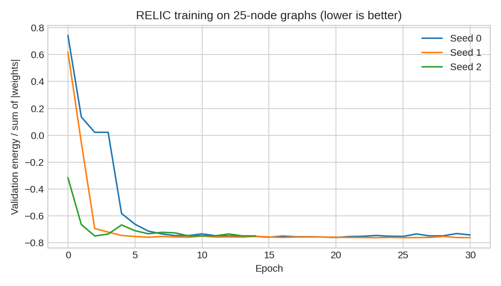
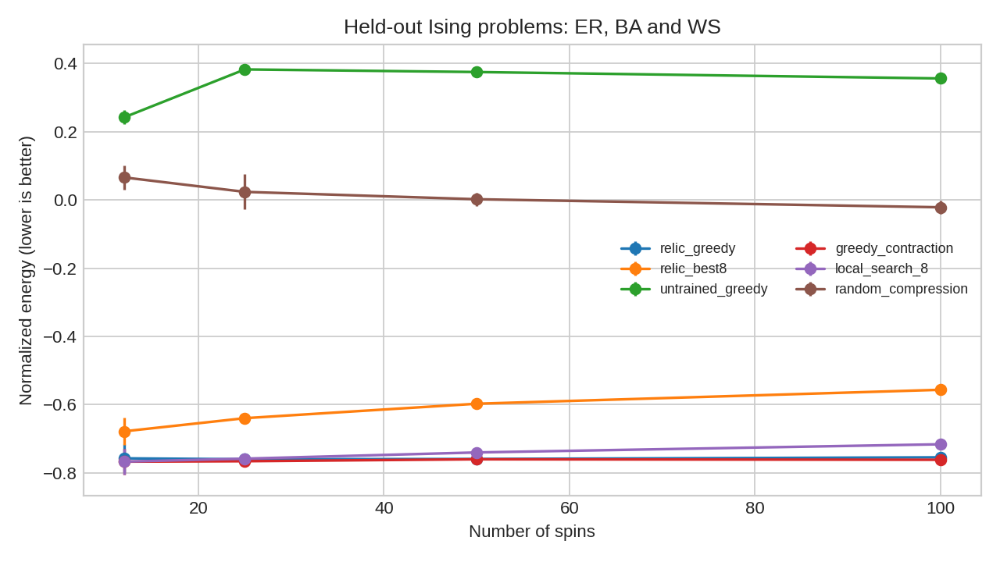
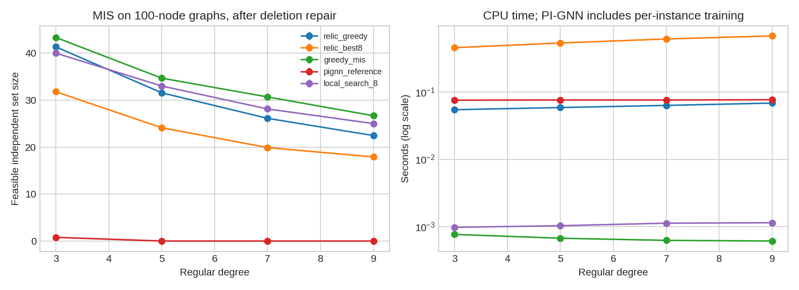

# Measured results

These are desktop reproduction measurements, not the numbers reported in the paper. Lower Ising energy is better; larger feasible MIS size is better.

## Training

| Seed | Initial validation energy / scale | Best validation energy / scale | Best epoch | Epochs run | Seconds |
|---|---:|---:|---:|---:|---:|
| 0 | 0.7439 | -0.7615 | 20 | 30 | 115.5 |
| 1 | 0.6202 | -0.7634 | 23 | 30 | 117.5 |
| 2 | -0.3162 | -0.7507 | 2 | 14 | 54.4 |

## Exact small Ising comparison (12 spins)

| Method | Mean energy gap to optimum | Mean normalized gap | Optimum hit fraction |
|---|---:|---:|---:|
| relic_greedy | 0.7153 | 0.0097 | 0.815 |
| relic_best8 | 5.1624 | 0.0889 | 0.667 |
| untrained_greedy | 57.8275 | 1.0093 | 0.000 |
| greedy_contraction | 0.0000 | 0.0000 | 1.000 |
| local_search_8 | 0.0000 | 0.0000 | 1.000 |
| random_compression | 48.6778 | 0.8330 | 0.000 |

## Generalization to 100-spin Ising problems

| Method | Normalized energy (mean ± SEM) | Mean seconds |
|---|---:|---:|
| relic_greedy | -0.7543 ± 0.0086 | 0.0552 |
| relic_best8 | -0.5563 ± 0.0104 | 0.4463 |
| untrained_greedy | 0.3562 ± 0.0073 | 0.0514 |
| greedy_contraction | -0.7615 ± 0.0091 | 0.0022 |
| local_search_8 | -0.7160 ± 0.0072 | 0.0010 |
| random_compression | -0.0214 ± 0.0203 | 0.0025 |

## MIS results at 100 nodes

| Method | Raw feasible fraction | Mean raw size | Mean repaired size | Mean seconds |
|---|---:|---:|---:|---:|
| greedy_contraction | 1.000 | 29.42 | 29.42 | 0.0026 |
| greedy_mis | 1.000 | 33.83 | 33.83 | 0.0007 |
| local_search_8 | 1.000 | 31.53 | 31.53 | 0.0011 |
| pignn_reference | 0.944 | 0.28 | 0.19 | 0.0759 |
| relic_best8 | 0.000 | 32.86 | 23.42 | 0.5681 |
| relic_greedy | 0.917 | 30.44 | 30.36 | 0.0611 |
| untrained_greedy | 0.139 | 68.28 | 27.53 | 0.0675 |

## Interpretation and limits

- Three training seeds share the same fixed training and validation graphs. Test graph seeds are disjoint. No test result selects checkpoints.
- For descriptive SEM, first average model seeds within each graph, then treat graphs as the sampling units. Error bars are one SEM, not 95% confidence intervals. There are only three graphs per topology/size or degree/size configuration.
- The best-of-8 policy uses eight sampled trajectories; greedy RELIC uses one. The greedy trajectory is not included among those samples, so best-of-8 can be worse, as it is in these runs. Runtime reports those unequal budgets explicitly.
- Random compression, greedy contraction, and restarted local search are controls. The PI-GNN reference is an independent small implementation, not the paper baseline or a tuned state of the art.
- MIS repair only deletes vertices. Raw validity is reported separately. Empty independent sets are valid but have zero size.
- The exact oracles are restricted to 12-spin Ising and 16-node MIS problems. Larger-instance quality has no optimality certificate.
- Neither the 4,000-node claims, original dataset, nor RTX 3060 timing comparison is reproduced here. This code recomputes message passing at every contraction; linear total runtime is not guaranteed.

Raw data: [Ising CSV](ising.csv), [MIS CSV](mis.csv), [instances](instances.npz), [solutions](solutions.json), [verification](verification.json), [protocol](protocol.json).
